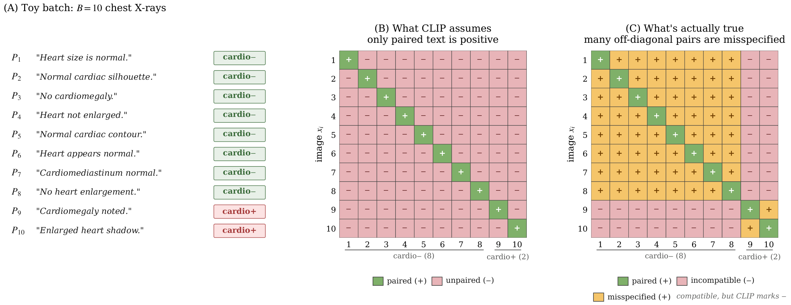
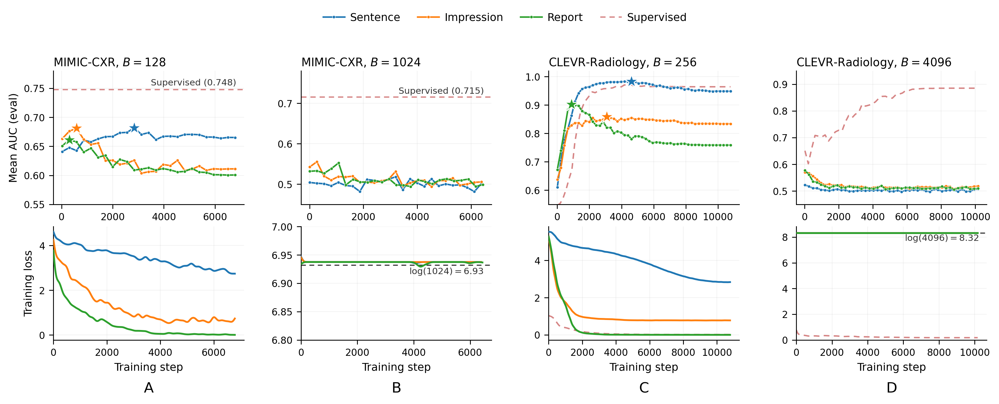
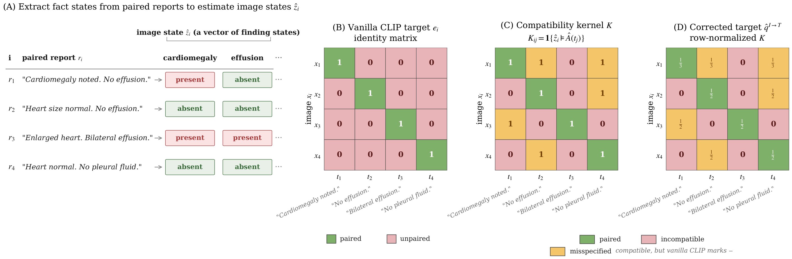
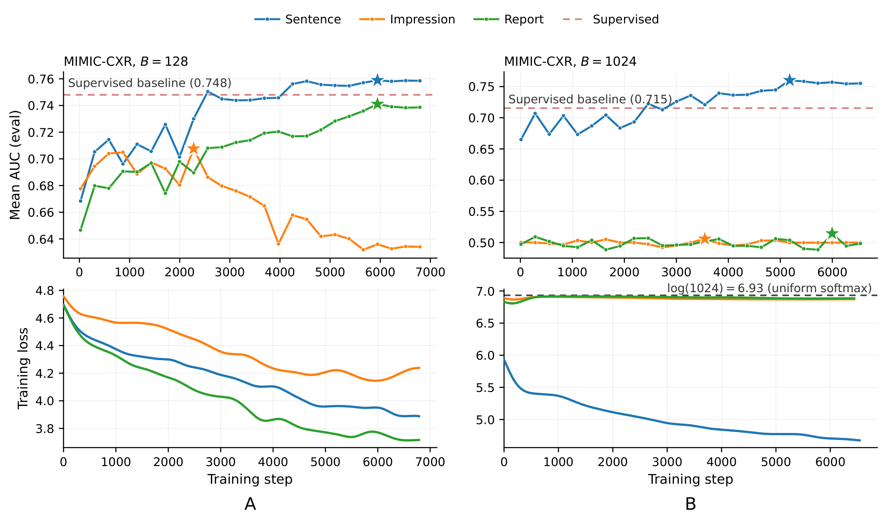

# CorLIP: Rethinking Contrastive Targets in Radiology Language-Image Pretraining

**NeurIPS 2026**

Yunhe Gao, Ashwin Kumar, Jiaming Liu, Chong Wang, Maya Varma, Fuying Wang, Stefania L. Moroianu, Louisa Fay, Sergios Gatidis, Akshay S. Chaudhari, Curtis Langlotz

Center for Artificial Intelligence in Medicine and Imaging (AIMI), Stanford University

[[Paper (arXiv)]](https://arxiv.org/abs/2611.24016) · [[NeurIPS page]](https://neurips.cc/virtual/2026/loc/atlanta/poster/148888) · [[BibTeX]](#citation)

---

## TL;DR

Medical CLIP inherits a *paired-identity* target from general-domain CLIP: each image has exactly one positive report, and every other report in the batch is a negative. In radiology, many unpaired reports state the same clinical findings, so this target is **systematically biased, not merely noisy**. We show that this single bias explains two well-known failures of medical CLIP, and that a minimal fix to the target, **CorLIP**, removes both.

<p align="center">
  
</p>
<p align="center"><em>A toy batch of chest X-ray reports. CLIP marks every off-diagonal pair as negative (B), but most of them are clinically compatible with the image (C, yellow).</em></p>

## Two failures of medical CLIP

- **O1: Rise-then-fall.** Zero-shot AUC peaks early and then degrades while training loss keeps decreasing. A supervised classifier on the same backbone shows no such drop.
- **O2: Large-batch collapse.** At batch sizes that help general-domain CLIP (e.g., B=1024), training fails to learn: AUC stays near random and loss stays near log B.

Both failures also appear on **CLEVR-Radiology**, a synthetic testbed that keeps only the overlapping-fact structure of radiology data and removes everything else (image appearance, clinical language, annotation noise).

<p align="center">
  
</p>

## Why it happens

We decompose the vanilla CLIP gradient into a **semantic** part, which pulls the image toward every text that is true of it, and a fixed **identity** part, which pushes apart compatible but unpaired texts.

- Once semantic learning saturates, only the identity part remains and rewards shortcut cues (wording, devices, markers) that single out the paired text, which produces **O1**.
- The identity part grows with batch size and dominates the gradient from the first step at large B, which produces **O2**.

## CorLIP: correct the target, not the architecture

CorLIP replaces the paired-identity target with a **fact-compatibility** target: a text is positive whenever its clinical assertions agree with the image. Fact states are extracted offline from the paired reports (CheXbert-13d or MedGemma-30d), and the row-normalized compatibility matrix is used as the contrastive target. The architecture, optimizer, and batch construction are unchanged.

<p align="center">
  
</p>

## Results

- **Removes the post-peak drop.** Sentence-level CorLIP keeps its peak performance through the end of training.
- **Makes large batches useful.** CorLIP sentence training is the only evaluated configuration that stays stable up to B=2048, with peak AUC improving up to B=512.
- **Amplifies the value of more data.** Doubling data barely helps vanilla CLIP but substantially helps CorLIP.
- **Transfers across tasks and modalities.** Gains hold on out-of-distribution classification, phrase grounding, a SigLIP-style loss, and 3D CT.

<p align="center">
  
</p>

## Code

Coming soon.

## Citation

```bibtex
@inproceedings{gao2026corlip,
  title     = {Rethinking Contrastive Targets in Radiology Language-Image Pretraining},
  author    = {Gao, Yunhe and Kumar, Ashwin and Liu, Jiaming and Wang, Chong and Varma, Maya and Wang, Fuying and Moroianu, Stefania L. and Fay, Louisa and Gatidis, Sergios and Chaudhari, Akshay S. and Langlotz, Curtis},
  booktitle = {Advances in Neural Information Processing Systems},
  year      = {2026}
}
```
